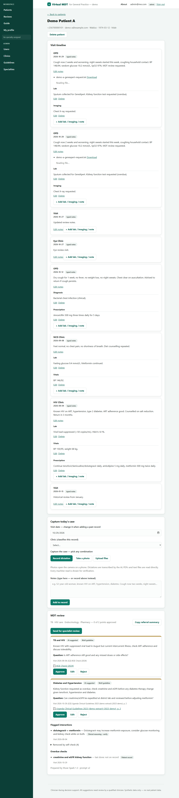

# Virtual MDT for General Practice

Live deployment: https://virtualmdt.hk-technologies.net

A virtual multidisciplinary team (MDT) for general practice: a medical officer at a
district hospital or Health Centre IV photographs or dictates a complex case, and an
AI agent prepares a structured, evidence-cited MDT brief — per-specialty concerns,
drug-interaction flags, overdue screening checks, and questions for referral —
which the clinician reviews, edits, and approves.

> **Clinician-facing decision support only.** This tool does not diagnose,
> prescribe, or advise patients. Every AI suggestion must be reviewed and signed
> off by a qualified clinician. Hackathon development uses **synthetic data only**
> — no real patient data.

Built for the **Build for Your World** track of the Meta Global AI Developer
Hackathon (26 Oct – 4 Nov 2026).

## Built during the hackathon (26 Oct – 4 Nov 2026)

- Case capture: photo / dictation / upload / typed notes with AI transcription.
- Add Result on any visit: typed lab/imaging/vitals notes plus photo capture,
  file attach, record-and-transcribe dictation (Muse Voice Transcribe — no
  browser speech API ever sees patient audio), and audio recording — visits
  auto-refresh as machine reads and summaries land.
- Verification markers ("N reads to verify") on visit cards and patient cards;
  visits can be deleted with confirmation; patient list search.
- MDT agent: specialty planning, patient + guideline RAG, draft, self-check audit.
- Brief screen with persisted approve / edit / reject sign-off and safety panels
  (flagged interactions, overdue checks, removed-by-self-check audit).
- Specialist reviews: specialty routing, email links, text/voice/photo responses,
  pending → responded → closed, no-duplicate gate.
- Guideline library: PDF upload, page-aware indexing, verified page citations.
- Patient portal (OTP login) with release-gated AI visit summaries
  (English/Kiswahili/Luganda), doctor–patient follow-up Q&A in all three
  languages, and releasable referral letters, clinics master, admin
  user/specialty management, mobile drawer navigation, in-app user guide,
  demo data seeding.



## How it works

1. **Capture** — Doctor photographs today's notes / patient-held books and dictates
   the consultation.
2. **Timeline** — AI structures the case and shows a short timeline of previous
   visits; the doctor corrects it.
3. **MDT review** — Doctor taps "Prepare MDT review". The agent selects relevant
   specialties (e.g. HIV care, TB, cardiology, endocrinology, pharmacy, mental
   health, nutrition), gathers cited evidence per specialty, and self-checks its
   draft for unsupported claims.
4. **Decision** — Doctor accepts, edits, or rejects each point, then manages the
   patient or refers with the brief attached.
5. Every item is marked **AI-suggested** or **clinician-approved** (audit trail).

Demo scenario: a 52-year-old on ART for HIV, with hypertension and diabetes,
presenting with a two-week cough. The agent flags TB screening, a possible
interaction to check if TB treatment starts, and an overdue kidney function test —
each with an evidence-source badge (MoH guideline / patient record / clinical
reasoning) and a guideline citation that names the exact page and opens it.

## Where the AI models are used

Every AI call in this app goes to Meta's models or to the self-hosted
retrieval server — Muse Spark (briefs, summaries, vision reads, translations),
Muse Voice Transcribe (all dictation and voice notes), and the local
embedding/rerank server. No third-party AI vendor ever sees patient content:
there is no browser or phone-vendor speech recognition anywhere in the app
(the old live-dictation path was removed for exactly this reason), and no
OpenAI/Google endpoints. All model access goes through one OpenAI-compatible
client (`backend/app/llm/client.py`, LiteLLM), so endpoints stay swappable
without touching features. `LLM_PROVIDER=echo` returns deterministic canned
output for the test suite — no keys, no network.

| Capability | Model | Notes |
|---|---|---|
| Brief plan, draft, self-check | Muse Spark (`LLM_MODEL`, default `openai/muse-spark-1.3`) | JSON-mode calls in `mdt.run_brief`; prompts in `backend/app/llm/prompts.py` |
| Photo reads | Muse Spark vision (`LLM_VISION_MODEL`, falls back to `LLM_MODEL`) | Transcribes slips and books; every read needs staff verification |
| Dictation and voice notes | Muse Voice Transcribe (`LLM_TRANSCRIBE_MODEL`, default `muse-voice-transcribe-1.0`) | Consults in English as-is; patient answers in Luganda/Kiswahili/English become English text with the original kept |
| Visit and patient summaries, question translation | Muse Spark | Trilingual summaries; overall message from signed-off points only |
| Embeddings | bge-base-en-v1.5 on the self-hosted `model_server/` (or `LLM_EMBED_MODEL` via API) | Patient and guideline vectors; `LLM_EMBED_DIM` must match (768) |
| Guideline reranking | ms-marco-MiniLM-L-6-v2 cross-encoder on `model_server/` | Top 4 of 20 candidates per query; falls back to vector order if down |
| Deterministic, no model | — | Referral letters, PDF/text extraction, PII redaction |

## How information flows

1. **Capture** — typed notes, visit sections, and files land on a visit
   (`POST /api/patients/{id}/visits`, sections, `…/visits/{visit_id}/attachments`).
2. **Machine reads** — `mdt.transcribe_attachment` reads each file (vision for
   photos, speech-to-text for audio — the audio is then deleted and never
   served, deterministic parse for PDF/TXT/MD) into a transcription shown as
   *AI read — verify* until staff confirm or correct it.
3. **Index and summarize** — `mdt.embed_patient_chunks` embeds notes, sections,
   and reads into per-patient vectors; `mdt.summarize_visit` drafts the
   trilingual visit summary. Any later content resets it to draft.
4. **Review** — `mdt.run_brief`: plan (specialties chosen only from the Admin
   list) → retrieve (patient vectors plus guideline vectors, cross-encoder
   rerank) → draft → self-check (unsupported points removed with reasons kept
   visible). Prompts carry de-identified text only: age, never date of birth;
   names, phones, and emails redacted — photograph clinical content, not name
   labels, since redaction cannot clean image pixels.
5. **Sign-off** — approve / edit / reject is persisted per item; only
   approved/edited wording flows downstream.
6. **Send, refer, release** — specialist reviews by email link; deterministic
   referral letters whose history includes photo and dictation reads; and the
   release gates that publish summaries and letters to the patient portal.

Steps 2–4 run as Celery tasks (Redis queue, `worker` service in compose).
Without a running worker nothing after capture processes — run one locally
(see below) or set `CELERY_TASK_ALWAYS_EAGER=1` for inline execution.

## Specialist review workflow

After the brief is ready, the case can be sent to specialists for input:

1. **Prepare MDT review** — On the patient record, tap "Prepare MDT review".
   The agent plans (choosing only from the specialties configured under
   Admin → Specialties, so the brief's specialties match review routing),
   retrieves patient history plus guideline evidence (wide vector net re-ranked
   by the cross-encoder), drafts, and self-checks in a background job; the page
   polls until the brief lands. Reopening the record resumes the latest finished
   brief, so sign-off survives a reload.
2. **Sign off** — Approve, edit, or reject each point. Every change is saved
   server-side and badged `AI-suggested` → `clinician-approved` / `edited` /
   `rejected` (audit trail). Points carry the specialty's question for the
   doctor, an `Urgent` flag when same-day action is needed, and a footer naming
   the model and prompt (`Prepared by Muse Spark 1.3 · prompt v2`). Points the
   self-check dropped are kept visible under a collapsed
   `Removed by self-check (n)` audit list with the reason for each — they can
   never be signed off or sent to specialists.
3. **Send for specialist review** — Tap "Send for specialist review". The
   specialties the brief is about come pre-ticked: everyone in a ticked
   specialty is notified, anyone can be unticked, and specific people can be
   hand-picked instead. Each recipient gets an email with a link that opens
   the review directly once signed in.
4. **Sent, not duplicated** — While a review is open (`pending`/`responded`),
   the patient page shows "Sent - waiting for review" with a link, and no new
   brief can be prepared. Close the review to start another round.
5. **Respond** — Specialists open it from Reviews → Assigned to me and reply
   in text, by voice recording (transcribed; the audio itself is never kept
   or served), or with a photo attached. The requester is emailed on each
   response. Reviews the user sent live under Requested by me.
6. **Close** — The requester (or an admin) closes the review when the loop is
   complete. Reviews are never approved/rejected — they are responded to.

Admins manage the routing under Admin → Specialties (e.g. HIV care,
Cardiology, Pharmacy) and can delete a patient record in full (visits, files,
vectors, briefs, reviews, login codes) from the record page.

## Patient portal and clinician release

AI-written text reaches patients only through a clinician release gate —
every summary starts as `draft` and the portal serves `released` ones:

1. **Visit summaries** — Recording a visit drafts a plain-language line in
   English, Kiswahili, and Luganda (decided items only: tests ordered,
   medicines continued, return date — never suspected or ruled-out
   conditions). Regenerating a released summary returns it to draft.
2. **Review and release** — On the patient record, each visit card shows its
   draft summary in English with the Kiswahili and Luganda versions one tap
   away. The doctor edits any language, then taps **Release to patient**; the
   portal labels it `Reviewed and shared by Dr. [name] on [date]`.
3. **Overall message** — After signing off the brief, the doctor taps
   **Prepare patient summary**: the worker drafts the overall message from
   approved/edited points only (suggested and rejected points, interactions,
   and overdue checks are never included), for the same edit-and-release.
4. **Portal** — Patients sign in with a one-time code and see only released
   text. Anything still in draft shows `Your doctor is preparing your
   summary.` Reading the portal never generates or publishes anything.
   Visits recorded before the gate existed are queued with
   `docker compose exec backend python backfill_visit_summaries.py` —
   they land as drafts for review, never published directly.
5. **Referral letters** — After sign-off, the doctor drafts a referral letter
   from the approved/edited points only (deterministic text, no model call):
   demographics, recent history (including photo and dictation machine reads,
   tagged verified or unverified), agreed findings, flagged interactions,
   overdue checks, and the reason. Each letter is released like a summary and
   appears in the portal, so the patient can present it at any facility they
   end up attending — even a different hospital than intended.

## Tech stack

| Layer    | Technology                                  |
|----------|---------------------------------------------|
| Frontend | Next.js (React)                             |
| Backend  | FastAPI (Python)                            |
| Database | PostgreSQL (pgvector-enabled for retrieval) |
| AI       | Meta Model API: Muse Spark (multimodal + agent), Muse Voice Transcribe |
| Retrieval| Self-hosted model server: bge-base embeddings + MiniLM cross-encoder rerank |
| Queue    | Redis + Celery (transcription, indexing, summaries, briefs) |
| Deploy   | Docker Compose + Caddy (same-origin: `/api/*` → backend, rest → frontend) |

## Repo layout

```text
frontend/                  Next.js app
backend/                   FastAPI app
deployment/docker-compose/ docker-compose.yaml, Caddyfile, .env (local only, never committed)
model_server/              local embedding + rerank server (sentence-transformers)
docs/demo-cases.md         synthetic hero demo case (Patient A)
```

## Clinical guidelines

Guideline PDFs are uploaded by an admin (Admin → Guidelines) and are **not**
shipped in this repo. Editions used for the demo and acceptance run:

- Uganda Clinical Guidelines 2023, Ministry of Health (test upload during
  development; re-upload the licensed copy on each deployment).

Guidelines uploaded before page-aware indexing need one **Reindex** (Admin →
Guidelines → Reindex) so brief citations carry verified page numbers.

## Getting started

### Prerequisites

- Node.js 20+, Python 3.11+, Docker + Docker Compose
- A Meta Model API key (`META_API_KEY`)

### 1. Configure environment

```bash
cp deployment/docker-compose/.env.example deployment/docker-compose/.env
# then edit .env and set your real META_API_KEY (never commit this file)
```

### 2. Run with Docker Compose

```bash
cd deployment/docker-compose
docker compose up --build
```

### 3. Run services individually (dev)

```bash
# Backend
cd backend
python -m venv .venv && source .venv/bin/activate  # Windows: .venv\Scripts\activate
pip install -r requirements.txt
uvicorn app.main:app --reload

# Frontend (new terminal)
cd frontend
npm install
npm run dev

# Background worker (new terminal — needs Redis running; transcriptions,
# summaries, and briefs only process with this running, otherwise set
# CELERY_TASK_ALWAYS_EAGER=1 on the API process for inline execution)
cd backend
celery -A app.mdt.tasks.celery_app worker --loglevel=info
```

> Frontend dev runs on another port than the API, so set
> `NEXT_PUBLIC_API_URL=http://127.0.0.1:8000` (or your backend origin) before
> `npm run dev` — otherwise the browser cannot reach the backend. Compose does
> not need this (same-origin under Caddy).

## Backend API

Users and auth (FastAPI, served same-origin under `/api` in compose):

- `POST /api/auth/register` — `{email, password, full_name?}` → 201 + user
- `POST /api/auth/login` — form `username` (= email) + `password` → `{access_token}`
- `GET /api/auth/me` — Bearer token → current user
- `GET /api/health` — liveness check

Backend settings come from `deployment/docker-compose/.env` (see `.env.example`):
`SECRET_KEY` signs the login tokens — set a long random value, never commit it.

Patient records and result sections:

- `POST /api/patients/{patient_id}/visits/{visit_id}/sections` — `{section, content}` → typed lab/imaging/vitals/note entry
- `POST /api/patients/visits/{visit_id}/attachments` — multipart `files` → photo/dictation/document attached to an existing visit (same AI read as capture)
- `DELETE /api/patients/visits/{visit_id}` — removes a visit with its sections, files, and reads
- `GET /api/patients` and `GET /api/patients/{id}` — carry `open_review_count` and `unverified_read_count` triage signals

## Testing

Backend (echo provider — no keys, no network, tasks run inline):

```bash
cd backend
python -m pytest tests -q
```

Frontend has no test harness; type-check with `npx tsc --noEmit` from `frontend/`.

## Safety and scope

- Clinician-facing only; questions and flagged concerns, not verdicts.
- Patients only ever see text a clinician has reviewed and released.
- Every point carries an evidence-source badge (MoH guideline / patient record /
  clinical reasoning) and links to its cited guideline page; the agent's
  self-check removes unsupported claims and keeps an audit of what it removed.
- Synthetic data only during the hackathon.

### Data protection

- **De-identified by design.** Names, dates of birth, phone numbers and email
  addresses never leave the database towards the AI model: the case summary
  carries age (not date of birth), and every staff-typed note, visit section
  and machine-read transcript is stripped of the patient's own identifiers
  plus any other email or phone-like number before it is sent. Clinical
  content (dates, BP readings, lab values) is preserved.
- **Known limit — labelled photos.** A photograph of a labelled lab slip or
  patient-held book can expose a name to the vision model in the image pixels,
  which text redaction cannot remove. Photograph the clinical content, not the
  name label, wherever possible.
- **Local first.** Embeddings and reranking run on the self-hosted model
  server, so patient text stays inside the deployment for retrieval; only the
  de-identified case text and evidence excerpts go to the Meta Model API for
  planning, drafting, self-check, vision reads and transcription.
- **Meta models only — no third-party AI vendors.** Every model call lands on
  Meta's API or the self-hosted retrieval server. Patient audio is never sent
  to a browser or phone-vendor speech API: the Add Result Dictate button
  records locally and posts the clip to Meta's transcription model, which
  returns text for editing.
- **Voice is transcription fuel only.** Clinicians dictate in English and are
  transcribed as-is; patient voice notes (English, Luganda, or Kiswahili) are
  transcribed to English text. The audio file is deleted once transcription
  succeeds and is never served to any user — text is what travels on slow
  connections. The original-language transcript is kept next to the English
  so bilingual staff can check the translation.
- **Access control.** Staff sign in with passwords (admin-managed accounts);
  patients use a separate OTP login that sees only their own record. Review
  links require sign-in.
- Future deployment must follow Uganda's Data Protection and Privacy Act, 2019.

## Roadmap

- [x] Concept note and demo scenario
- [x] Case capture (photo + dictation → structured record + timeline)
- [x] MDT agent (specialty selection, evidence retrieval, self-check)
- [x] Brief screen with approve / edit / reject flow (persisted server-side)
- [x] Specialist reviews (specialty routing, email links, text/voice/photo
      responses, pending → responded → closed, no-duplicate gate)
- [x] Guideline library (PDF upload, async indexing with retry, RAG citations)
  - Guidelines uploaded before page-aware indexing need one **Reindex** (Admin →
    Guidelines → Reindex) so brief citations carry verified page numbers.
- [x] Referral letter generation (bonus) — drafted from signed-off points,
      released like a summary, carried by the patient to any facility
- [x] Patient follow-up in Luganda / Swahili / English — staff questions
      auto-translated for the portal; answers by text or voice note

## Contributing

Issues and pull requests are welcome. Please keep all test data synthetic and
never commit secrets (`.env` files) or patient-like data.

## License

MIT — see [LICENSE](LICENSE).
